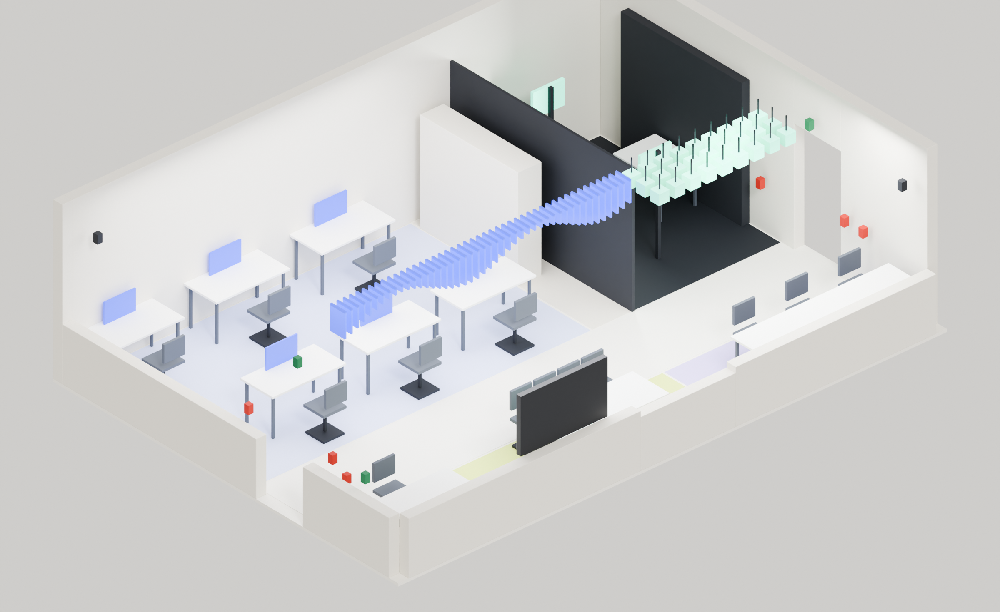

# PARALLAX CV Lab

PARALLAX is a final-year design project for a Signal and Computer Vision teaching laboratory: one 70 m² room and the digital service that runs it. It covers the physical space, the student experiment journey, and the faculty and technician tools behind it, and delivers them as a 3D room model, a design edition, a working prototype and a React application.



## What is in the project

| Area | Description |
|---|---|
| Student journey | Prepare, reserve a compatible kit, check in, run an experiment, interpret the evidence and submit. Two experiments are modelled end to end: E01 (signal) and E06 (vision). |
| Operations | Technician and faculty views for bookings, attendance, assets, calibration and assessment, joined by one cross-role fault thread from report to verified recovery. |
| Lab map and 3D | A canonical room geometry (`spatial/lab_geometry.json`) drives the Blender model, the renders, the interactive map and the scene studio. |
| Sustainability | Environment and energy views with a worked energy-operation example. |
| Guide assistant | An optional local assistant that answers only from reviewed project guides and cites the passage it used. It runs against a local Ollama model; nothing is sent to a cloud service. |
| Submission packet | Final report, presentation, poster, walkthrough video, presenter notes and an evidence index. |

## Repository layout

```text
apps/
  lab-web/       React + TypeScript + Vite application
  lab-server/    Local guide-assistant service (Node, Ollama adapter)
  lab-shared/    Guide registry shared by the app and the service
design/          Design edition pages, design system, Figma captures, 3D prototypes
prototype/       Dependency-free demonstrator of the core journeys
research/        Desk research, sources, traceability and test plan
spatial/         Room geometry, Blender scripts, GLB exports and renders
planning/        Delivery records, decisions and build scripts
submission/      Report, deck, poster, video, demo sequence and evidence index
```

## Getting started

Requirements: Node.js 24 (verified with 24.13) and npm. Ollama with `llama3.2:3b` is needed only for the guide assistant.

```bash
npm --prefix apps/lab-web ci
```

### Run

| Command | What it starts | Address |
|---|---|---|
| `npm start` | Design edition and prototype | http://127.0.0.1:4180 |
| `npm run lab:dev` | React application (development) | http://127.0.0.1:4190 |
| `npm run assistant:start` | Guide-assistant service | http://127.0.0.1:4192 |
| `node submission/serve.cjs 4180` | Submission packet entry page | http://127.0.0.1:4180/submission/index.html |

All servers bind to loopback only. The assistant accepts browser requests from ports 4180, 4190 and 4191; see [apps/lab-server/README.md](apps/lab-server/README.md) for its configuration and limits.

### Build and test

```bash
npm run lab:build
```

```bash
npm run lab:test
```

```bash
npm run assistant:test
```

```bash
npm run check
```

`npm run check` runs the prototype, design-system, 3D and geometry validators. `node submission/validate.cjs` checks the submission packet.

## Key documents

- [Final report](submission/PARALLAX-Final-Report.pdf), [presentation](submission/PARALLAX-Presentation-Final.pptx) and [poster](submission/PARALLAX-Poster.pdf)
- [Evidence index](submission/EVIDENCE_INDEX.md): each requirement mapped to its evidence and remaining boundary
- [Application verification](apps/lab-web/VERIFICATION.md)
- [Research synthesis](research/U02_RESEARCH_SYNTHESIS.md) and [source register](research/U02_SOURCE_REGISTER.md)
- [Space and 3D](spatial/PHASE_04_SPACE_AND_3D.md) and [design system](design/PHASE_05_DESIGN_SYSTEM.md)

## Scope and limitations

This is a design and local-demonstrator project. The research is desk-based; no interviews, surveys or participant usability sessions were conducted. The application stores its records in the browser and uses prepared data: there is no shared database, institutional sign-in, live device integration or real notification delivery. Room dimensions, inventory and policies are modelled assumptions, not a surveyed site. The [evidence index](submission/EVIDENCE_INDEX.md) states the boundary for every requirement.

## License

Academic project. All rights reserved.
