# PARALLAX
UI/UX proposal for a 70 m² Signal & Computer Vision Lab
Local interactive edition, secondary research and conceptual physical design

## 1. Introduction

PARALLAX brings the physical laboratory and its digital workflow into one proposal. Students prepare an experiment, reserve its complete kit, identify the station, retain evidence, explain a comparison and close the session. Faculty review readiness and learning records. Technicians follow equipment impact, verification and handover. A separate public view communicates useful status without exposing private records.

The assignment supplies a 70 m² area. P4-D uses an assumed 10 × 7 m inner envelope with a 3 m height. The proposal combines computing, controlled image capture, a signal bench, collaboration, faculty support, storage and a clear circulation spine. These dimensions establish a reproducible design model. No site survey or occupied-room trial has established actual capacity, daylight, ventilation, services or access.

The delivered system is a runnable local React prototype supported by preserved Figma designs, fifteen wireframes, Blender source, generated scientific demonstrations and documented recovery paths. The smart dashboard and energy ledger use declared example records. The assistant performs real inference through local Ollama but reads only reviewed public project guides. The intended contribution is a coherent, inspectable proposal with explicit source and authority boundaries. Learning improvement, actual energy savings and institutional operating approval remain unmeasured.

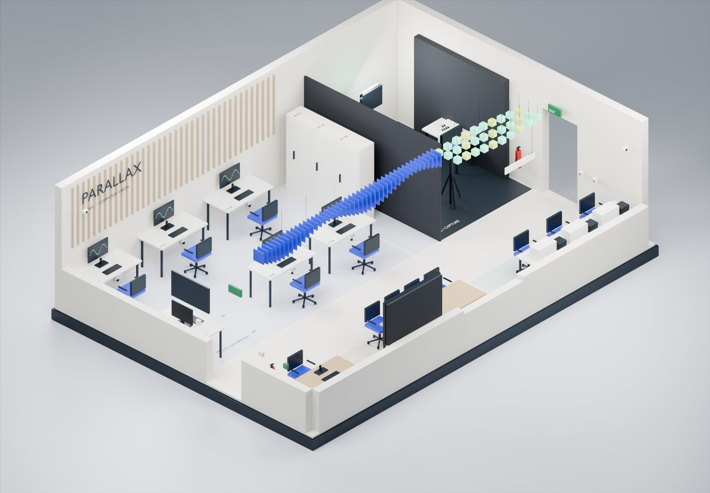

Evidence: PARALLAX_EXCELLENCE_BLUEPRINT.md; spatial/lab_geometry.json; planning/EXCELLENCE_EXECUTION_PHASES.md

## 2. Problem Analysis

The design problem spans scientific reasoning, shared resources and physical access. A student can hold a station reservation while a required accessory is missing. A displayed curve can look convincing while its sampling conditions remain ambiguous. A saved draft can appear complete before a submission receipt exists. An available asset can still be unsuitable for a task, and a recent-looking dashboard value can have a disconnected source.

These are prospective failure consequences and authored scenarios. The project does not establish their frequency in the intended cohort. The research traceability records twenty requirements, twelve assumptions and eight design decisions. Each requirement connects a problem, source rationale, wireframe and implementation boundary. Rejected shortcuts include a composite room-safety score, generic idle power-off, automatic physical setup transfer and an assistant that invents browser evidence.

The resulting design preserves distinctions that matter to a decision: availability versus occupancy, preparation versus training permission, recorded context versus current context, generated samples versus measured data, and draft versus confirmed receipt. Technical checks examine the implementation of these distinctions. A participant outcome or a real institution's policy cannot be inferred from passing domain tests.

Problem | Design response | Evidence
--- | --- | ---
Incomplete shared kit | Reserve all dependencies for one interval | R01-R03; U07 tests
Evidence loses its context | Freeze source, method and settings at capture | R05-R07; U04/U05 tests
Recovery appears complete too early | Pending receipt and verification gates | R08-R13; migration tests
Unknown data looks authoritative | Source age, gap and manual fallback | R14-R20; smart-lab tests

Evidence: research/U02_TRACEABILITY.csv; research/U02_HYPOTHESIS_REVIEW.md; research/U02_DESIGN_DECISIONS.md

## 3. User Research

The agreed research method is secondary research and design-artifact analysis. Local participants: zero. Interviews, surveys, recruitment, participant usability sessions and field observation are excluded by the user's scope decision. Fourteen public sources were reviewed. This focused review is not a systematic literature review or a claim of saturation. The register distinguishes full text, abstract-only, indexed partial access and an unread correction.

Five education or provenance studies inform evidence comparison and record reconstruction. Two institutional operating pages inform training, booking and fault ownership. WCAG, ventilation guidance and LEAF inform digital access and sustainability questions. Two AI education studies inform bounded assistance. Two public discussion threads generate questions and counterexamples. External findings support a design rationale, while local behavior, pain frequency and learning effects remain unknown.

The six role lenses are first-run students, returning students, faculty, technicians, administrators and visitors. Personas and empathy maps are explicitly hypothetical. Their jobs concern preparation, reconstructing evidence, supporting a cohort, restoring equipment, reconciling resources and finding a public destination. Invented quotations and demographic preferences do not appear as findings. The journey follows discover, prepare, reserve, arrive, run, compare, reflect, submit and return, with named ownership at transitions.

The synthesis prioritizes six tensions: defending evidence, securing the whole kit, understanding recovery state, interpreting room context, retaining independent reasoning with AI and maintaining usable access alongside spatial richness. The ranking reflects possible consequence and assignment relevance. It does not use invented reach, frequency or benefit scores.

Evidence: research/U02_SOURCE_REGISTER.md; research/U02_DESK_RESEARCH_METHOD.md; research/U02_RESEARCH_SYNTHESIS.md; research/PHASE_02_RESEARCH_AND_EXPERIENCE.md

### User personas

Six role lenses, written as jobs to be done. Authored for testing; not validated biographies. Source: U02 research synthesis.

ID | Role | Tier | Job to be done | Trigger → outcome | Still to check locally
--- | --- | --- | --- | --- | ---
PA | First-run student | Primary | When a practical is unfamiliar, identify the method, complete kit and next action so I can begin with an understood question. | First preparation → explain the task and readiness requirements | Previous familiarity, how preparation happens, acceptable help and real stopping points
PB | Returning / advanced student | Primary | When conditions change, reconstruct and compare what I actually recorded so I can defend a bounded interpretation. | Variation, failed capture or later report → trace evidence without rewriting history | Current notebook habits, significance of parameter differences, preferred comparison depth
PC | Instructor | Primary staff | When preparing or teaching a cohort, distinguish readiness from learning so I can offer the right support. | Upcoming practical or confusing evidence → a support action, not a completion ranking | Assessment expectations, attendance ownership, what readiness signals actually mean
PD | Technician | Primary staff | When an asset fails or a kit returns incomplete, establish impact and ownership so the next user has a reliable status. | Incident or handover → restriction, repair verification and clear next action | Existing SOPs, notification responsibility, inventory accuracy and release authority
PE | Administrator | Secondary | When reviewing demand and resources, reconcile definitions and scope so I can make a documented decision. | Planning review → qualified utilisation and resource evidence | Real reporting period, permitted data, baseline and denominators
PF | Visitor | Tertiary | When finding the lab or an activity, obtain useful location information without seeing private operational records. | Arrival and orientation → accessible destination and public explanation | Signage comprehension, public information policy and physical access

### Empathy map

Empathy map for the first-run student during the vision experiment, with the instructor and technician maps beside it. Every entry is an anticipated hypothesis from the Phase 2 record. No participant said, thought or felt these; zero participants were studied.

Aspect | PA · First-run student — During the vision experiment | PC · Instructor — Running a teaching session | PD · Technician — Handling a faulty camera kit
--- | --- | --- | ---
Likely says | Which camera are we supposed to use?; Is this the right cable? | Has everyone checked in? Which station is free? | When did this stop working? Who had it last?
Likely thinks | Everyone else seems to know what they're doing.; Did I save that? | Two kits are probably incomplete again. | Who else booked this kit this week?
Likely does | Checks the brief on a phone; Waits for the instructor; Retakes captures | Walks the room; marks attendance; fixes setups; answers repeated questions. | Tests the device; searches for accessories; updates a log; tells faculty.
Likely feels | Anxious at setup; Relieved after the first good capture; Uncertain about the report | Stretched across stations; frustrated by preventable delays. | Interrupted; responsible for problems they could not see coming.
Pains | Incomplete kit; Unclear first step; Lost settings | No readiness signal; manual attendance; inconsistent evidence quality. | Symptom-free reports; unknown last user; no link from a fault to future bookings.
Gains | A clear checklist; Confidence before arriving; Evidence that writes the report's method | Readiness at a glance; attendance from check-in; rubric linked to evidence. | Structured reports with asset ID; automatic impact on bookings; verification record.

### User journey map

Student journey for vision experiment E06 (J1). Emotions and pain points are anticipated hypotheses (H-numbered in the Phase 2 record), not observations. Touchpoint codes refer to the page and component specifications.

Stage | Discover | Prepare | Reserve | Arrive & check in | Capture | Analyse | Document | Submit & return
--- | --- | --- | --- | --- | --- | --- | --- | ---
Likely emotion | Curious | Uncertain | Neutral | Anxious | Focused | Engaged | Tired | Relieved
Actions | Opens assigned experiment | Reads objective, checks prerequisites | Picks time, reserves full kit | Finds station CV-03, verifies kit | Sets lighting and camera, captures | Runs detection, compares lighting conditions | Records observations and limits | Submits revision, returns kit
Touchpoints | P02, P04 | P05 | P06, P07 | Signage, P10, P11 | Capture zone C1, P12 | P14 | P15 | P16, P11 return
Pain points | Too many similar experiments | Kit list unclear (H01) | Room booked, devices not (H02) | Missing accessory (H01) | Light changes mid-capture (H10) | Confidence read as correctness (H12) | Settings lost (H03) | Unclear if submission is final
Opportunities | Topic filters, duration, prerequisites | Checklist that transfers to booking | Complete-kit reservation with conflicts | Same manifest at check-in; report issue inline | Recording indicator; settings captured automatically | Confidence vs ground truth explained | Evidence embeds with provenance | Stable revision + return checklist

## 4. UI/UX Methodology

The project translates source evidence into requirements, compares alternatives, builds annotated wireframes and then implements the selected local workflow. The original phase-01 through phase-10 work and the later U01 through U10 upgrades are distinct histories. Dated delivery records retain the chronology instead of rewriting early plans as completed studies.

U01 preserves identities, fixtures, geometry and original entrypoints. U02 revises research under the desk-only scope. U03 migrates local functional parity to React. U04 adds the dashboard, observation provenance and sustainability ledger. U05 adds scientific rehearsals and fault consequences. U06 grounds local AI. U07 tests an independent operations desk. U08 completes authored art and physical proposals. U09 checks and refines the current implementation. U10 assembles this submission and its demonstration handoff.

Review combines designer walkthroughs, source integrity, domain tests, browser evidence and rendered artifact checks. The fourteen system scenarios examine conflicts, retries, retained context, policy changes, fault isolation, interrupted verification, unavailable models, public projections and scene lifecycle. A scenario's local closure is separate from a connected service or a human outcome. Changes receive preserved before evidence, bounded implementation, retest evidence and a stated residual limit.

Review method | What it establishes | What it cannot establish
--- | --- | ---
Source and unit checks | Rules, scientific identities and immutability | Institutional authorization
Browser/designer walkthrough | Rendered actions, messages and fallback paths | Student comprehension
Automated accessibility scan | Covered machine-detectable conditions | Full WCAG or spoken AT usability
Rendered report/deck review | Pagination, legibility and layout | A human presenter's delivery pace

Evidence: planning/U02_DELIVERY_RECORD.md; planning/REMAINING_WORK_AUDIT_2026-10-04.md; planning/U09_DELIVERY_RECORD.md

## 5. Design Process

The visual system uses editorial typography, restrained blue accents, paper-toned surfaces and explicit task hierarchy. Forty component families and eighty-seven Figma variants support consistent state language. Student work starts with a named experiment. Staff tools use separate destinations. Task headings, source labels, recovery messages and next actions carry the information hierarchy across desktop, narrow and public views.

The physical and digital artifacts share canonical identities. C1-CAM and both C1 lights appear in the kit, map, fault impact and standby review. P4-D supplies the model coordinates and plan layers. REF-2HZ-v1 supplies the signal calculations and art. E06 lighting images remain authored illustrations. This shared source avoids inconsistent diagrams without claiming that a model measures the physical installation.

The final audit found three bounded UI issues. The typed-ID field omitted its explicit text type and missed the intended 16 px/44 px styling. Product copy still named older upgrade stages. The QA scan retained another route's result after navigation. The refinement corrects all three, preserves the previous release and adds a visible exact-text export alternative. Copied scene modules now own frame cancellation and resource disposal. Original models and scientific calculations remain preserved.

Physical proposals include six wayfinding/safety sign studies, five canonical plan layers and specifications for maintainable lighting, ventilation, protected power, repairable furniture and traceable materials. Trade-offs and responsible roles accompany each proposal. Procurement, circuit mapping, occupied-room measurement and qualified review remain outside this concept delivery.

Six wayfinding and safety sign studies, S-01 to S-06. Conceptual designs; no signage has been installed or approved.

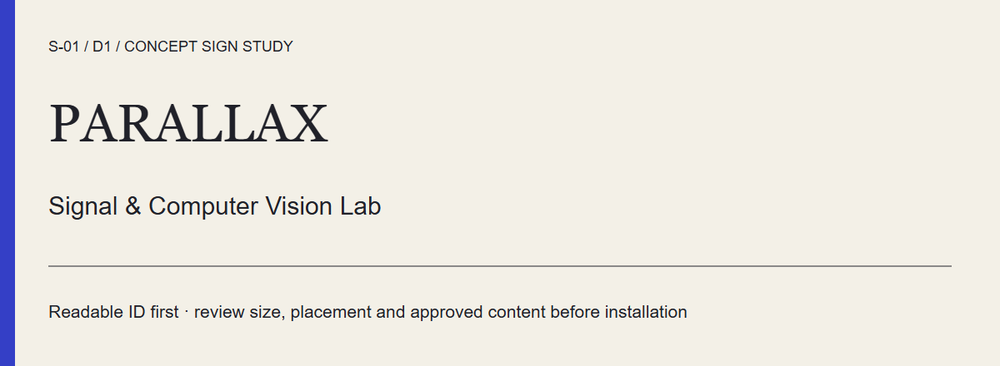
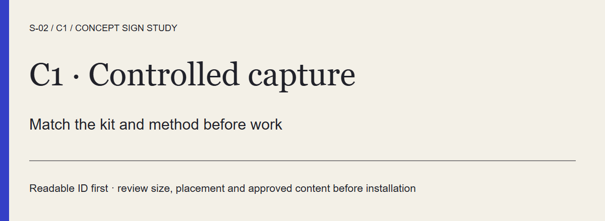
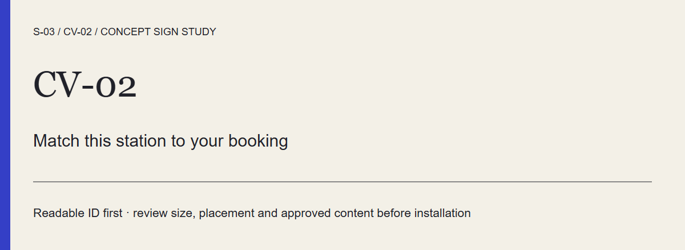
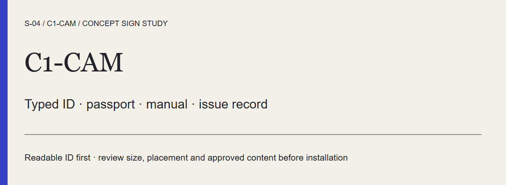
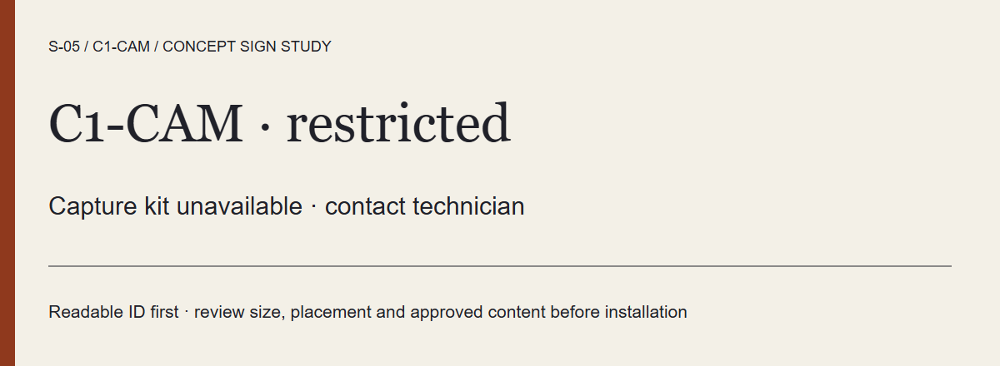
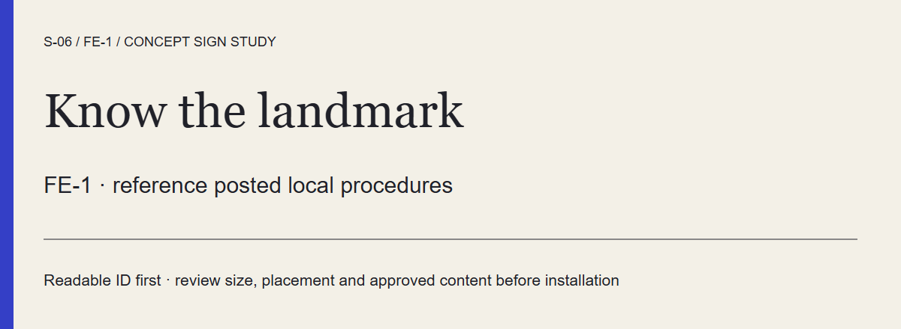

Evidence: design/system/components.json; planning/U08_DELIVERY_RECORD.md; apps/lab-web/evidence/u09-final/mobile-after.json; planning/revisions/U09-before-implementation/manifest.json

## 6. Wireframes

The fifteen annotated boards cover preparation, booking, arrival, evidence comparison, notebook, submission, technician recovery, public display and supplementary faculty/asset tasks. Twelve original block layouts remain preserved. Three supplementary boards cover cohort readiness, attendance correction and asset movement. An annotation names the relevant requirement, source, decision and implementation boundary.

WF03 shows complete-kit booking and conflict recovery. Its student-facing refusal identifies the resource clash and retains a compatible alternative. WF06 makes retained evidence, changed conditions, uncertainty and student reasoning visible. WF11 separates report, classification, restriction, repair, verification and restoration. The final app tests these local states, while the structural boards do not imply every hypothetical faculty interaction has a connected backend.

The editable board data and generator remain in design/wireframes. The local review page provides all fifteen SVGs and their source annotations. The Figma file retains the high-fidelity library and linked prototype paths. The current submission index points to these artifacts and the React edition without replacing the historical designs.

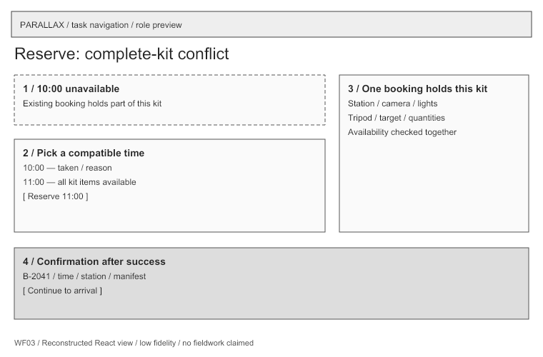

From wireframe to interface. Left: WF03, the authored booking structure. Right: the reservation step as built, with the same time slots and whole-kit manifest.

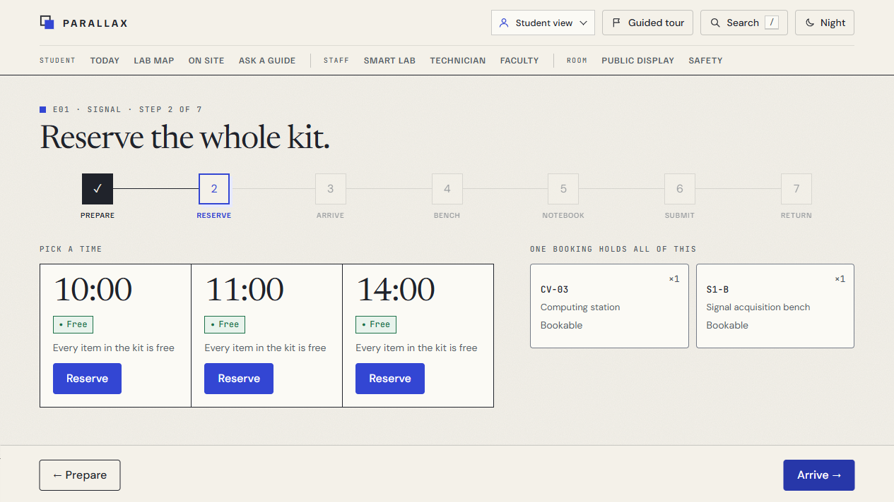

WF06, retained evidence comparison, and WF11, technician recovery. Authored structures from the fifteen-board packet.

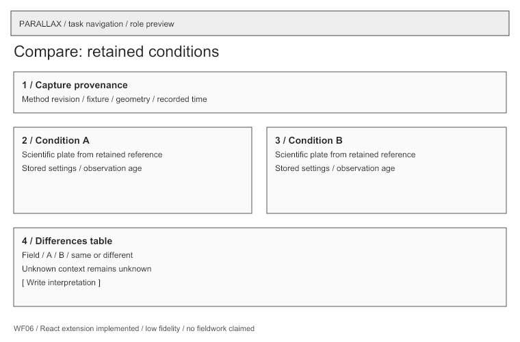
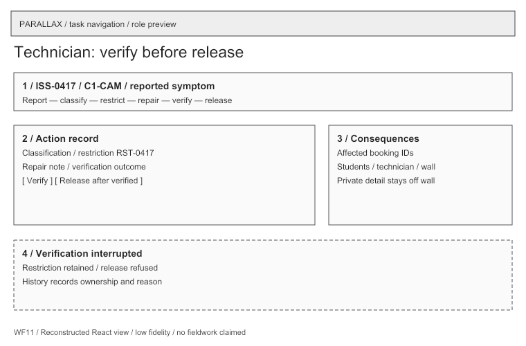

Evidence: design/wireframes/index.html; design/wireframes/boards.json; research/U02_DESK_REVIEW.md; design/figma-build/README.md

## 7. Final Prototype

The current React edition delivers student E01/E06 paths, faculty and technician views, booking/check-in, typed equipment lookup, asset/calibration records, the linked map and a public projection. Local browser persistence preserves drafts and supports conflict/recovery behavior. Prepared actors and receipts are examples. No institutional account, authoritative booking database, real attendance service or grade delivery is connected.

The smart dashboard combines the same local resource state with explicit source context. Six observation scenarios distinguish missing, recent, delayed, invalid and disconnected records. The energy ledger separates watts from kilowatt-hours and preserves missing intervals. A standby proposal protects active dependencies and essential services. It shows modelled upper bounds rather than measured savings.

E01 retains a 2 Hz, 1 V sine reference over one second. Sampling at 3 Hz produces four inclusive samples and a signed -1 Hz alias fitting the same values. The 4 Hz zero-phase boundary is ambiguous. At 20 Hz, twenty-one samples are retained. E06 uses ILL-L1-v1 and ILL-L2-v1 images to discuss illumination, without detector accuracy claims. The separate geometry rehearsal holds P4-D fixed while changing horizontal field of view.

The assistant uses installed local Ollama llama3.2:3b to select published guide sections. The server verifies revision and fingerprint before and after inference and returns the reviewed passage wording with its citation. Missing context, provider failure, cancellation and withdrawn guides fail into bounded recovery/manual reading. The independent operations desk and ten-stage fault sandbox preserve the primary student record.

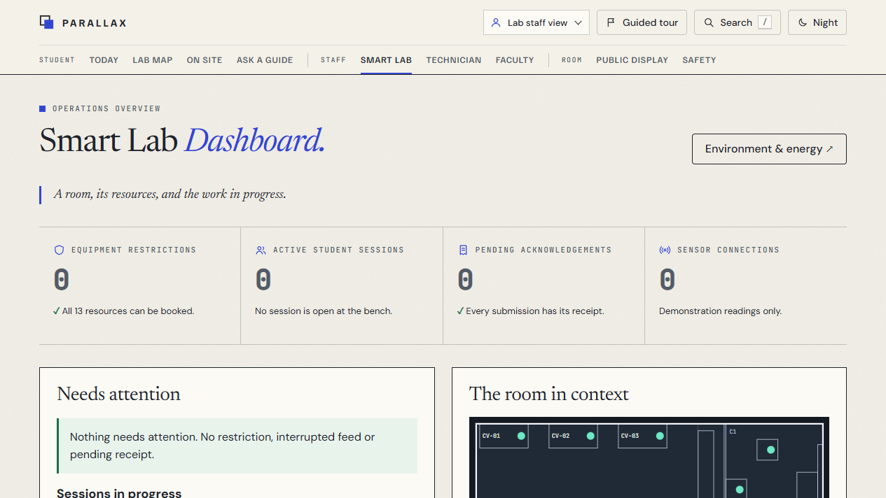

Left: E01 rehearsal at 3 Hz, a generated teaching fixture. Right: fault sandbox stage 8, where early release is refused.

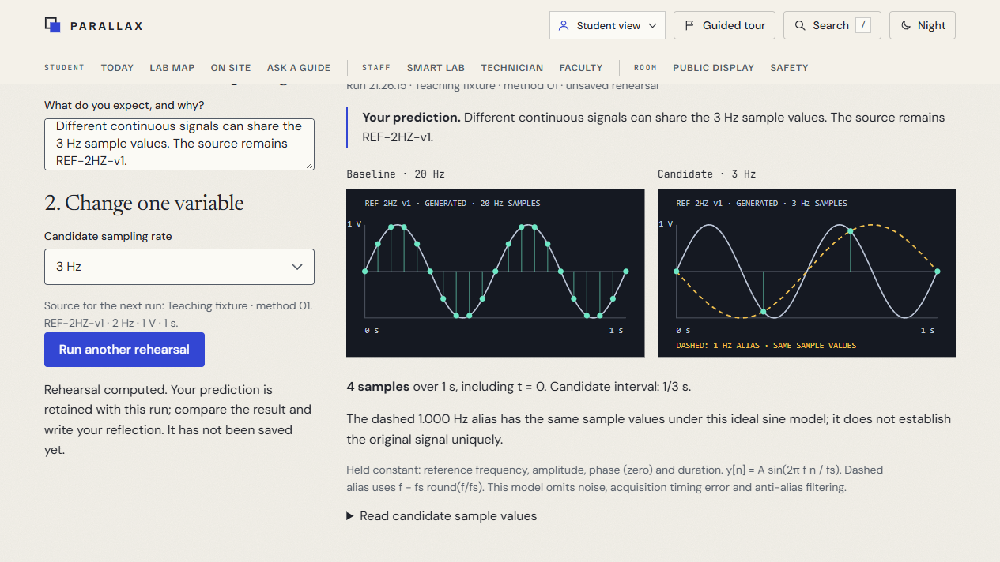
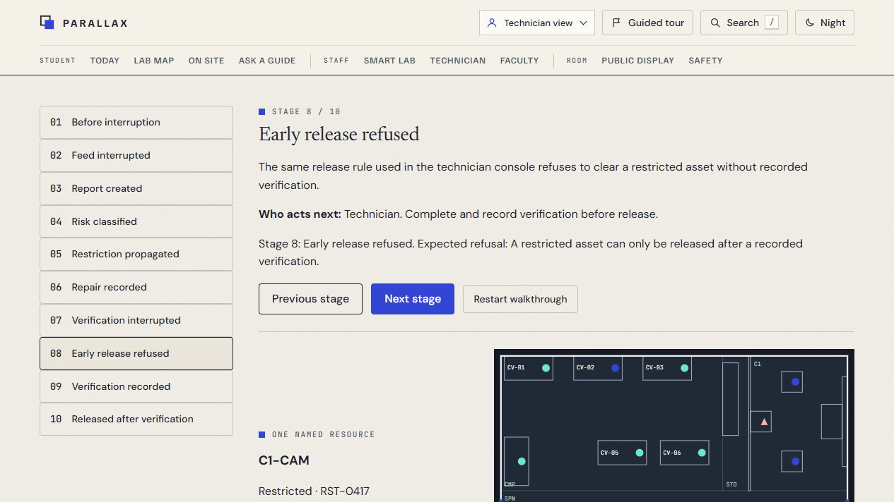

### Smart features, and how real each one is

Feature | Status | What exists
--- | --- | ---
Digital experiment manual | Working | The question, the kit and a safety check before every session.
Equipment lookup by label | Working | Typing the printed ID opens the record. Camera scanning is a concept.
AI assistant | Working | Local Ollama model answering from reviewed guides, with the cited section.
Digital twin | Working | One geometry drives the live plan and the optional 3D model.
Equipment health | Working | A fault restricts the asset everywhere until a recorded verification.
IoT sensors | Simulated | Example readings with their source and age. No hardware is connected.
Smart energy monitoring | Simulated | Interval energy and a booking-aware standby preview. No meter.
AR / VR learning | Partly | A 3D scene rehearsal runs in the browser. Headset AR is a concept.
Voice assistant | Concept | Proposed for hands-busy bench work. Not built in this prototype.

The same table appears on the prototype dashboard. "Working" means it runs in the local prototype with example records; it does not mean an institutional service is connected.

Evidence: apps/lab-web/PARITY.md; planning/U04_DELIVERY_RECORD.md; planning/U05_DELIVERY_RECORD.md; planning/U06_DELIVERY_RECORD.md; planning/U07_DELIVERY_RECORD.md

## 8. Floor Plan

P4-D partitions the assumed 70 m² room into computing 24.96 m², storage 3.12 m², capture 10.92 m², circulation 15.00 m², faculty 3.20 m², collaboration 7.04 m² and signal work 5.76 m². Their sum is 70 m². The source declares metres, an origin at the north-west inner wall, x east and y south. The design retains a 1.5 m spine and a 1.2 × 0.9 m accessible workstation approach.

The C1 camera-to-stage distance is 2.05 m under the planning model. Entry/exit, first aid, extinguisher, electrical isolation, CCTV and ventilation appear as labelled conceptual landmarks. Power/network and installation layers identify proposed service locations. The window W1 and the collaboration zone inform daylight and ventilation questions while the capture area requires repeatable illumination.

Geometric checks confirm furniture stays inside the envelope, does not overlap the spine or each other, and retains the declared approach space. These checks establish model fit. They do not certify installed clearances, escape capacity, electrical protection, CCTV governance, airflow or safe occupancy. Whole-class teaching should use a reviewed rotation plan until actual capacity and supervision are established. The final handoff includes the editable Blender model, GLB views, renders and canonical geometry.

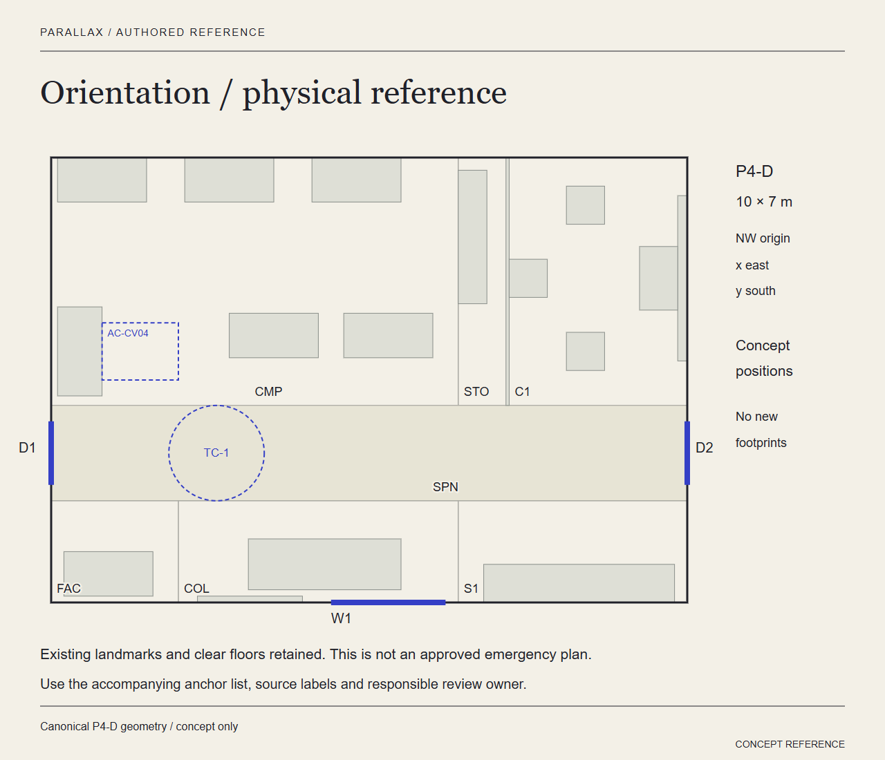

Evidence: spatial/lab_geometry.json; spatial/exports/upgrade-validation.json; planning/U04_SUSTAINABILITY_SPECIFICATION.md; apps/lab-web/public/studio/reference.md

## 9. Technology Stack

The current client uses React 19.3.0, TypeScript 7.0.2, Vite 8.3.2 and React Router 8.4.0 with pinned package-lock dependencies. Typed domain adapters preserve legacy fixture/rule behavior while cloning mutable input. Local storage uses versioned keys for the primary React example, rehearsals and operations exercise. These stores are local records and cannot implement shared multi-client transactions.

Three.js and retained P4-D geometry power optional scene views. Accessible 2D/list/text alternatives accompany them. The refined generated copies own animation frames, resize observation, controls and disposable GPU resources. The original scene/model source is preserved. QA-only route/scene/performance receipts remain explicit and collect no external telemetry.

The Node assistant service binds to loopback port 4192. The edition uses 4180, React development uses 4190 and isolated validation uses 4191. Ollama runs locally at 11434 with the installed completion model. The adapter rejects remote hosts/models and browser evidence. Reviewed guide JSON supplies facts and lifecycle metadata. The service has anonymous local session isolation, bounded concurrency and in-memory request recovery, rather than institutional authentication.

The handoff distinguishes a prebuilt assessor preview from a source rebuild. Node/npm are needed for serving or rebuilding. An Internet connection is needed only to restore missing development dependencies. Ollama and the installed model are optional for live hints because the manual remains readable. No API key or cloud provider is required. Rebuilding or replacing the model requires the documented regression/evaluation checks.

Layer | Actual responsibility
--- | ---
Fixtures and geometry | Canonical IDs, source reference and assumed room
Domain / local persistence | Immutable records, local rules, drafts and retry state
React / Three.js | Task views, declared models and readable alternatives
Node / Ollama | Public-guide retrieval, passage selection and source validation
Figma / Blender / documents | Editable design, physical model and assessor evidence

Evidence: apps/lab-web/package.json; apps/lab-web/package-lock.json; apps/lab-server/README.md; submission/README.md

## 10. Conclusion

PARALLAX now supplies a coherent local proposal covering the assignment's physical and digital families, with a preserved original baseline, current prototype, scientific/source boundaries, sustainability specifications and recovery evidence. Its strongest supported outcome is inspectability: a reviewer can follow a source through a requirement, design decision, screen state and technical check.

The final source/build gate passes 139 React tests and 16 assistant service tests. Original checks retain 65 prototype, 25 scene and 16 spatial passes. The fresh narrow typed-ID control measures 16 px and 44 px with visible keyboard focus and no page overflow. Eight same-document scene remounts retain 22 geometries and three textures per renderer. Thirty-six two-frame feedback samples range below 26 ms on the local browser. These observations describe the tested machine and paths, without proving browser-wide leak freedom or general performance.

The fourteen scenario ledger explicitly distinguishes local test support from conditional integration. Late/out-of-order live stream ingestion remains unimplemented because the app has no live stream. This is a documented boundary rather than a fabricated passing sequence. The designer comparison walkthrough checks visible difference, uncertainty and next action without claiming student comprehension.

The remaining external verification list names spoken screen-reader use, actual browser zoom, a second browser/physical device, native download completion and a human presenter's rehearsal. Tool availability does not turn them into passes. Connected hardware, authenticated shared operations, institutional policies and physical installation approval remain future integrations. Team identities, actual contributions and the deadline year must be supplied by the team before institutional submission. No participant work or certification is invented.

Evidence: planning/U09_DELIVERY_RECORD.md; submission/EVIDENCE_INDEX.md; submission/EXTERNAL_CHECKS.md; apps/lab-web/evidence/u09-final/performance.json; apps/lab-web/evidence/u09-final/scene-lifecycle.json

## References

S01 - N. G. Holmes, C. E. Wieman and D. A. Bonn (2015). Teaching critical thinking. Reading scope: full. https://arxiv.org/abs/1508.04870

S02 - B. M. Zwickl, T. Hirokawa, N. Finkelstein and H. J. Lewandowski (2014; preprint revised 2 May 2014). An epistemology and expectations survey about experimental physics: Development and initial results. Reading scope: abstract. https://arxiv.org/abs/1310.1055

S03 - Martin M. Stein, Emily M. Smith and N. G. Holmes (2018 preprint). Confirming what we know: Understanding questionable research practices in intro physics labs. Reading scope: full. https://arxiv.org/abs/1807.04716

S04 - C. M. Rathnayaka et al. (full author list not verified) (Online 2023; journal issue 2024). Preparative pre-laboratory online resources for effectively managing cognitive load of engineering students. Reading scope: indexed-partial. https://www.tandfonline.com/doi/abs/10.1080/03043797.2023.2204813

S05 - Max Schröder, Susanne Staehlke, Paul Groth, J. Barbara Nebe, Sascha Spors and Frank Krüger (31 January 2022). Structure-based knowledge acquisition from electronic lab notebooks for research data provenance documentation. Reading scope: abstract. https://pubmed.ncbi.nlm.nih.gov/35101121/

S06 - University of Edinburgh · Confocal and Advanced Light Microscopy (Undated live page). CALM user guidelines and rules. Reading scope: full. https://clinical-sciences.ed.ac.uk/qmri-facilities/calm-confocal-and-advanced-light-microscopy/user-guidelines

S07 - University of Edinburgh · School of Biological Sciences (17 June 2024). Light Microscopy Core: Make a booking. Reading scope: full. https://biology.ed.ac.uk/drp/light-microscopy-core/make-a-booking

S08 - W3C (Recommendation; current linked edition). Web Content Accessibility Guidelines (WCAG) 2.2. Reading scope: full. https://www.w3.org/TR/WCAG22/

S09 - UK Health and Safety Executive (Live guidance). Using CO2 monitors. Reading scope: full. https://www.hse.gov.uk/ventilation/using-co2-monitors.htm

S10 - University College London (Live programme page). LEAF — Laboratory Efficiency Assessment Framework. Reading scope: full. https://www.ucl.ac.uk/about/sustainability/campaigns-and-initiatives/leaf-laboratory-efficiency-assessment-framework

S11 - Hamsa Bastani, Osbert Bastani, Alp Sungu, Haosen Ge, Özge Kabakcı and Rei Mariman (2025; correction notice 20 August 2025). Generative AI without guardrails can harm learning: Evidence from high school mathematics. Reading scope: full-main-correction-unread. https://www.pnas.org/doi/10.1073/pnas.2422633122

S12 - Greg Kestin, Kelly Miller, Anna Klales, Timothy Milbourne and Gregorio Ponti (3 June 2025). AI tutoring outperforms in-class active learning: an RCT introducing a novel research-based design in an authentic educational setting. Reading scope: full. https://www.nature.com/articles/s41598-025-97652-6

S13 - Anonymous public contributors, r/labrats (Public thread; displayed relative dates not converted to an exact publication date). Shared lab equipment booking — Am I alone?. Reading scope: full. https://www.reddit.com/r/labrats/comments/1pn49rd/shared_lab_equipment_booking_am_i_alone/

S14 - Anonymous public contributors, r/labrats (Public thread; displayed relative dates not converted to an exact publication date). Scheduling Shared Equipment. Reading scope: full. https://www.reddit.com/r/labrats/comments/17cgsjp/scheduling_shared_equipment/
